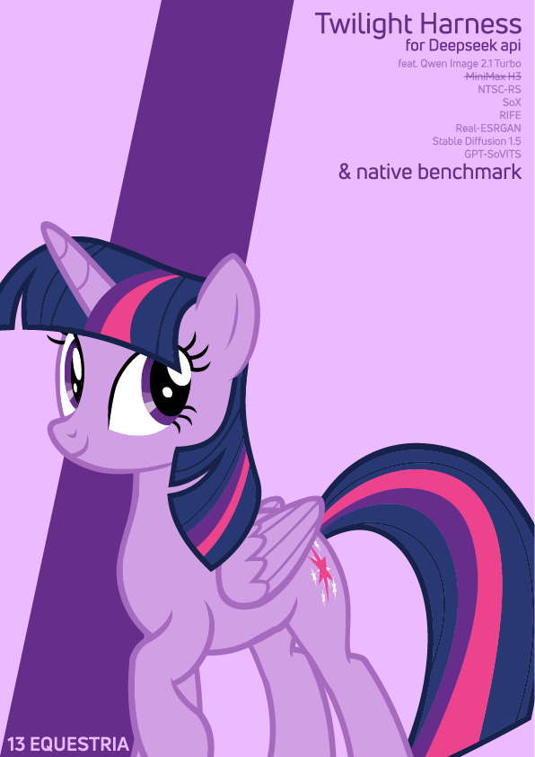
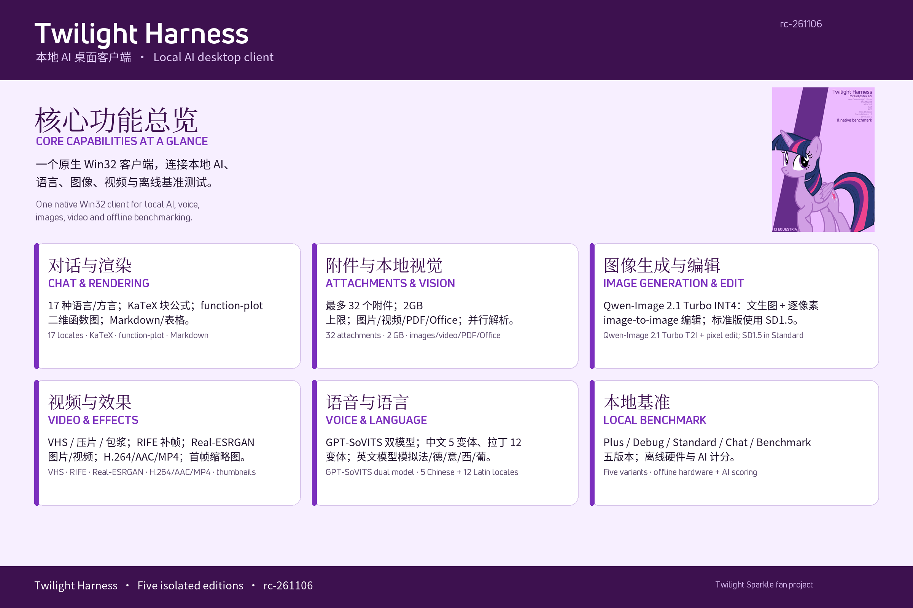
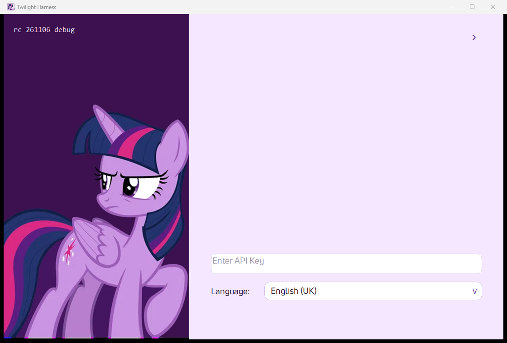
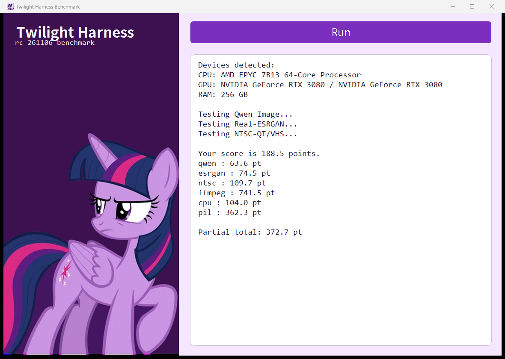

# Twilight Harness



**本地 AI 桌面客户端 / Local AI desktop client**  
`rc-261106` · Windows x64 · Native Win32

---

## 中文

### 五个版本

Twilight Harness 现在提供五个互相隔离的版本，各有独立运行目录、本地模型和配置。

| 版本 | 目录/程序 | 图片生成与编辑 | 附件 | Benchmark | 说明 |
| --- | --- | --- | --- | --- | --- |
| **Twilight Harness+** | `twilight-harness-plus` | Qwen-Image 2.1 Turbo INT4 | 32 个 / 2GB | 支持 | 最高级别客户版；移除 MiniMax H3 视频生成 |
| **Twilight Harness Debug** | `twilight-harness-plus-debug` | Qwen-Image 2.1 Turbo INT4 | 32 个 / 2GB | 支持 | 同 Plus；启动附带后台 CMD 控制台 |
| **Twilight Harness** | `twilight-harness` | SD1.5 INT8 | 32 个 / 2GB | 支持 | 完整核心功能，图片生成/编辑改用 SD1.5 |
| **Twilight Harness Chat** | `twilight-harness-chat` | 不提供 | 无 | 无 | 纯聊天；无附件、无需要附件的工具、无 Benchmark |
| **Twilight Harness Benchmark** | `twilight-harness-benchmark` | Qwen-Image 2.1 文生图测试 | 无 | 纯本地 | 无 API、无 Key、无语言选择、无聊天输入框 |

#### 功能差异

```text
Plus       = 聊天 + 附件 + Qwen 图像生成/编辑 + VHS/RIFE/ESRGAN + TTS + Benchmark
Debug      = Plus + 后台 CMD 控制台
Standard   = 聊天 + 附件 + SD1.5 图像生成/编辑 + VHS/RIFE/ESRGAN + TTS + Benchmark
Chat       = 聊天 + 17 语言 + KaTeX/function-plot + TTS；无附件、无 Benchmark
Benchmark  = 本地硬件/Qwen/ESRGAN/VHS 跑分；无 API、无聊天
```

### 核心功能



#### 对话与渲染

- 原生 Win32 双栏聊天；
- Markdown、表格、代码块；
- KaTeX 块级公式；
- function-plot 二维函数图；
- 流式 reasoning/content 双通道；
- 17 种语言/方言；
- 图片、视频首帧缩略图；
- 点击缩略图打开原图/视频。

#### 附件

- 最多 32 个；
- 总大小 2GB；
- 图片 PNG/JPG/WebP/BMP/GIF/TIFF；
- 视频 MP4/MOV/MKV/AVI/WebM/M4V/WMV/FLV/TS；
- PDF、DOCX、PPTX、XLSX/XLSM、旧 Office；
- 图片 OCR + 本地视觉；
- 视频元数据 + 首帧，不导入时拆帧；
- 4 线程并行解析；图片导入 18s → 0.39s。

#### 图像

- Qwen-Image-2.1-Turbo Universal INT4；
- 真正的逐像素 image-to-image：`/edit`、`qwen_edit`；
- SD1.5 INT8 文生图；
- Real-ESRGAN 图片 4×；
- 参考图 + 文生图（Qwen 使用视觉描述引导）；
- 生成图缩略图与导出目录。

#### 视频与音频

- VHS 化、压片、包浆；
- RIFE 补帧 2–30×；
- Real-ESRGAN 视频逐帧 4×；
- H.264 + AAC + MP4；
- 音轨分离、转码；
- GPT-SoVITS 中英双模型 TTS；
- 中文 5 变体、拉丁 12 变体；
- 动作/旁白清理、参考 prompt_text、停顿参数修正。

#### MiniMax H3

H3 运行时、`/video`、`/video --ref`、CPU Offload、INT4/INT8/BF16 切换和视频封装代码已经接入。

但 **H3 权重尚未下载完整**，当前不可用，也没有进行 H3 的 8GB/多卡/DirectML/CPU 生成验证。Plus 版本按需求移除 H3 能力；其余版本不会伪造 H3 结果。

### 17 种语言/方言

| # | 语言/方言 | 字体 | TTS |
| --- | --- | --- | --- |
| 1 | 简体中文（普通话） | Source Han Sans / 思源宋体 | 中文 ckpt，zh |
| 2 | 简体中文（粤语·广东） | Source Han Sans / 思源宋体 | 中文 ckpt，yue |
| 3 | 繁體中文（粵語·香港/澳門） | Source Han Sans / 思源宋体 | 中文 ckpt，yue |
| 4 | 繁體中文（華語·台灣） | Source Han Sans / 思源宋体 | 中文 ckpt，zh |
| 5 | 简体中文（华语·马来西亚） | Source Han Sans / 思源宋体 | 中文 ckpt，zh |
| 6 | English (UK) | Uni Neue | 英语 ckpt，en |
| 7 | English (US) | Uni Neue | 英语 ckpt，en |
| 8 | Français (France) | Uni Neue | 英语 ckpt 模拟 |
| 9 | Français (Canada, Québec) | Uni Neue | 英语 ckpt 模拟 |
| 10 | Français (Belgique) | Uni Neue | 英语 ckpt 模拟 |
| 11 | Italiano | Uni Neue | 英语 ckpt 模拟 |
| 12 | Deutsch (Deutschland) | Uni Neue | 英语 ckpt 模拟 |
| 13 | Deutsch (Österreich) | Uni Neue | 英语 ckpt 模拟 |
| 14 | Deutsch (Schweiz) | Uni Neue | 英语 ckpt 模拟 |
| 15 | Português (Portugal) | Uni Neue | 英语 ckpt 模拟 |
| 16 | Português (Brasil) | Uni Neue | 英语 ckpt 模拟 |
| 17 | Español | Uni Neue | 英语 ckpt 模拟 |

法语、德语、意大利语、西班牙语、葡萄牙语目前没有原生 TTS 模型，按需求使用英语模型模拟发音。

 

### rc-261026 之后新增

- 原生客户端取代 Tk；
- 32 附件多选、2GB 上限；
- 4 线程附件并行解析；
- Qwen-Image 2.1 Turbo INT4 文生图；
- Qwen 逐像素 image-to-image `/edit`；
- KaTeX 与 function-plot；
- 17 语言/方言与字体联动；
- TTS 英文模型、动作清理、停顿修正、参考 prompt_text；
- 五版本隔离构建；
- 原生离线 Benchmark UI；
- H.264/AAC/MP4 统一封装；
- 视频首帧缩略图；
- Tk 停止维护。

### 安装与运行

1. 解压对应版本分卷；
2. 进入目录，双击启动脚本或对应 EXE；
3. 首次启动填写 API Key；
4. TTS 首次使用会启动本机 GPT-SoVITS API，需要等待加载；
5. 图像/视频模型依赖 NVIDIA CUDA；CPU/DirectML 为降级路径。

系统：

- Windows 10/11 x64；
- 建议 16GB 以上内存；
- 建议 NVIDIA 8GB 以上显存；
- Plus 约 22GB；Standard 约 15GB；Chat 约 9GB；Benchmark 约 17GB；
- 公式/函数图使用本机 Microsoft Edge 渲染。

### Benchmark

Benchmark 版本不调用 API，没有 API Key、语言选择和聊天输入框。启动后点击 **Run**。



运行项目：

- CPU；
- PIL；
- ffmpeg；
- Qwen-Image-2.1-Turbo INT4 512×512；
- Real-ESRGAN；
- NTSC-QT/VHS。

#### 本测试平台

```text
CPU         AMD EPYC 7B13 64-Core Processor / 128 threads
RAM         255.9 GB
GPU         2 × NVIDIA GeForce RTX 3080 10GB
OS          Windows 11 x64
Runtime     Python portable + ONNX Runtime CUDA
```

#### 本次实测

| 项目 | 时间 | 分数 |
| --- | ---: | ---: |
| Qwen-Image 512×512 | 52.84 s | 56.8 pt |
| Real-ESRGAN | 4.39 s | 68.4 pt |
| NTSC-QT/VHS | 4.66 s | 107.3 pt |
| CPU | 1.17 s | 85.3 pt |
| PIL | 0.32 s | 380.8 pt |
| ffmpeg | 0.30 s | 677.7 pt |
| **总分** | | **178.6 pt** |
| 部分合计 | | 351.7 pt |

权重：

```text
Benchmark edition: qwen .35, esrgan .15, ntsc .10, ffmpeg .10, cpu .15, pil .15
Plus / Debug:      qwen .30, esrgan .15, ntsc .10, ffmpeg .10, cpu .20, pil .15
Standard:          sd15 .35, esrgan .15, ntsc .10, ffmpeg .10, cpu .15, pil .15
Chat:              无 Benchmark
```

分数受 GPU 占用、驱动和首次加载影响；这是本机本次实测。

### 使用的 AI 与组件

- Qwen-Image-2.1-Turbo Universal INT4；
- Qwen3-VL 视觉/文本编码器；
- Stable Diffusion 1.5 INT8 ONNX；
- GPT-SoVITS v2Pro（中文/英文）；
- Real-ESRGAN ncnn Vulkan；
- RIFE；
- MiniMax H3（代码接入，权重未完整，当前不可用）；
- FFmpeg / libx264；
- Microsoft Edge Headless + KaTeX 0.16.22 + function-plot 1.25.1；
- KaTeX、Source Han Serif/Sans、Uni Neue 归各自版权方所有。

### 字体

- 中文正文：**Source Han Sans / 思源黑体**
- 中文大小标题：**Source Han Serif / 思源宋体**
- 英文正文与标题：**Uni Neue**

GitHub 使用自身页面字体渲染 Markdown；仓库内 Banner、功能海报、截图和客户端界面使用上述字体。

### 许可

本项目为 Twilight Sparkle 同人项目，与 Hasbro / My Little Pony 官方无关。模型、字体、FFmpeg、KaTeX、function-plot 等遵循各自许可证。

---

## English

### Five isolated editions

| Edition | Folder / executable | Image gen/edit | Attachments | Benchmark | Notes |
| --- | --- | --- | --- | --- | --- |
| **Twilight Harness+** | `twilight-harness-plus` | Qwen-Image 2.1 Turbo INT4 | 32 files / 2GB | Yes | Top client edition; MiniMax H3 video removed |
| **Twilight Harness Debug** | `twilight-harness-plus-debug` | Qwen-Image 2.1 Turbo INT4 | 32 / 2GB | Yes | Same as Plus; opens a background CMD console |
| **Twilight Harness** | `twilight-harness` | SD1.5 INT8 | 32 / 2GB | Yes | Full core feature set with SD1.5 image gen/edit |
| **Twilight Harness Chat** | `twilight-harness-chat` | None | None | No | Chat only; no attachment-dependent tools |
| **Twilight Harness Benchmark** | `twilight-harness-benchmark` | Qwen-Image T2I test | None | Local only | No API, no API key, no language picker, no chat composer |

### Highlights

- Native Win32 client; no Tk release;
- 17 locales: 5 Chinese variants, 2 English, 3 French, 3 German, Italian, 2 Portuguese, Spanish;
- Latin UI uses **Uni Neue**; Chinese UI uses **Source Han Sans / Source Han Serif**;
- KaTeX block equations and function-plot 2D graphs;
- Up to 32 attachments / 2GB total, 4-thread import;
- Qwen-Image-2.1-Turbo INT4 text-to-image and true pixel image-to-image edit;
- SD1.5 edition for lower-VRAM or SD-only deployments;
- VHS, crush, patina, RIFE, Real-ESRGAN, H.264/AAC/MP4;
- GPT-SoVITS dual-language TTS; Latin languages simulated through the English checkpoint;
- Native offline benchmark with variant-specific weights.

### MiniMax H3 status

The H3 runtime, `/video`, `/video --ref`, CPU offload, quant switching and MP4 finalizer are implemented. The H3 weights are **not complete**; H3 generation is unavailable and has not been benchmarked. The Plus edition removes H3 by design. No H3 result is fabricated.

### Benchmark platform

```text
CPU:  AMD EPYC 7B13 64C/128T
RAM:  255.9 GB
GPU:  2 × NVIDIA GeForce RTX 3080 10GB
OS:   Windows 11 x64
```

Measured Benchmark edition: Qwen-Image 512×512 52.84s, Real-ESRGAN 4.39s, NTSC-QT 4.66s, CPU 1.17s, PIL 0.32s, ffmpeg 0.30s; **178.6 pt** total.

### Fonts and licenses

Source Han Sans (body), Source Han Serif (headings) and Uni Neue (Latin) are used in packaged UI and promotional assets. GitHub displays Markdown with its own page fonts. All third-party models/fonts remain under their respective licenses.

Twilight Sparkle is a fan project and is not affiliated with Hasbro or My Little Pony.
