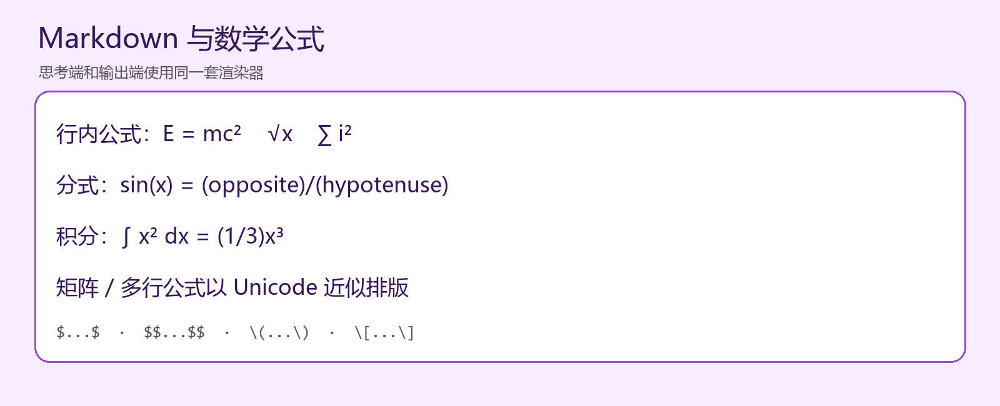
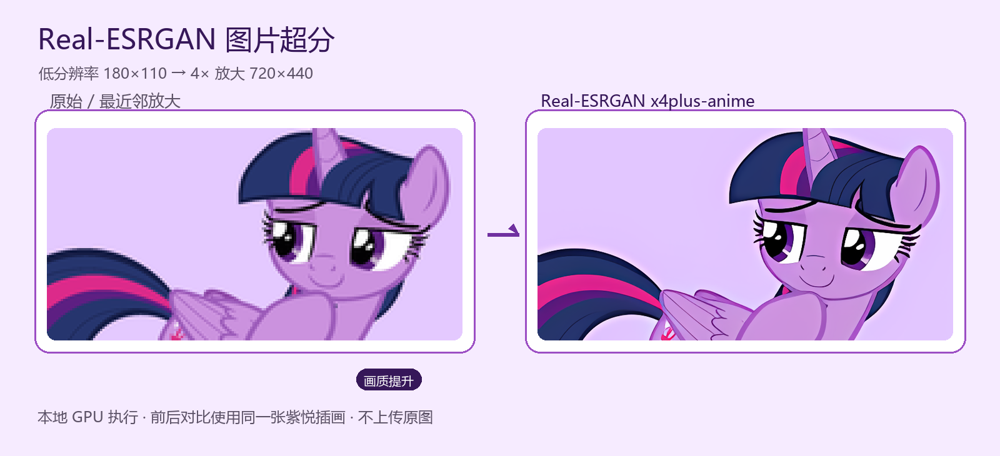
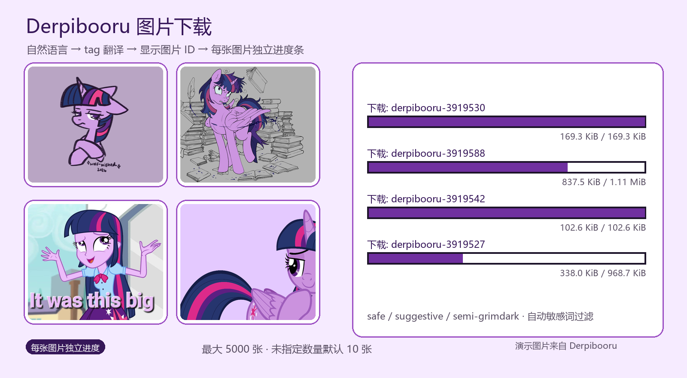
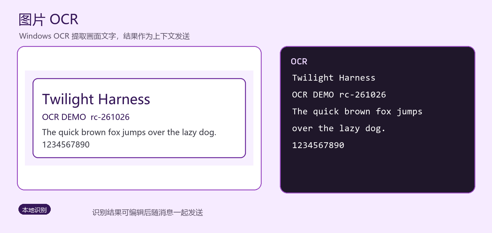
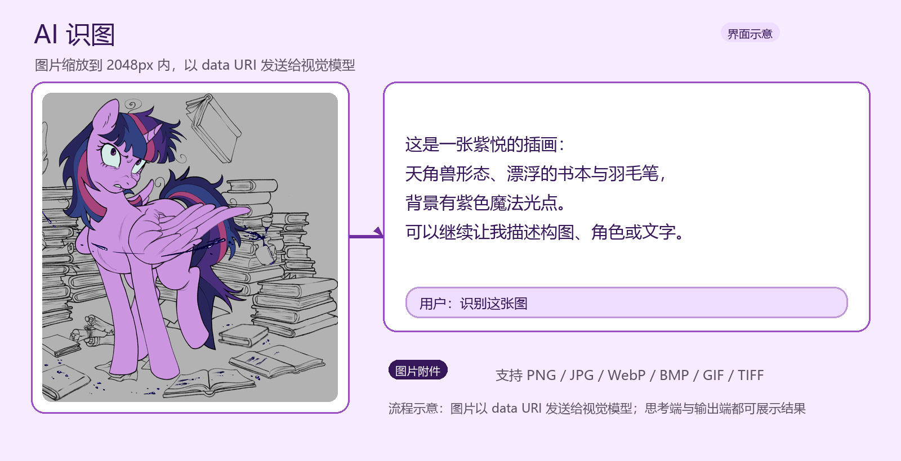
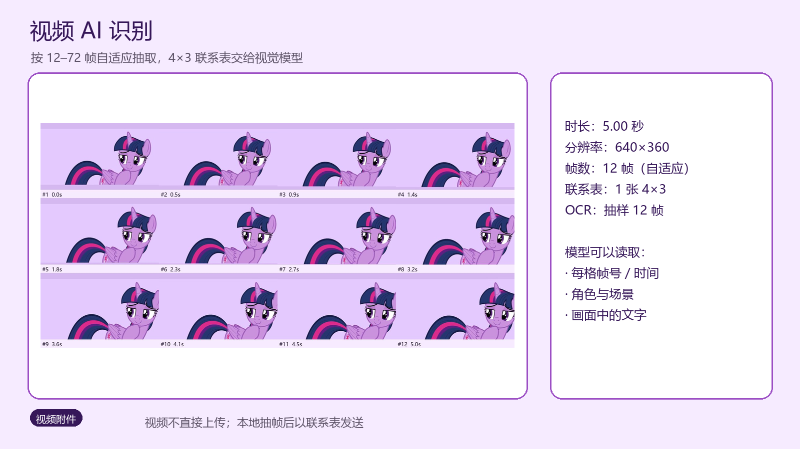
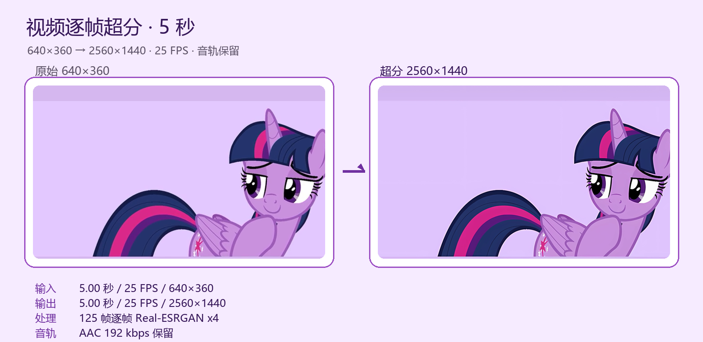
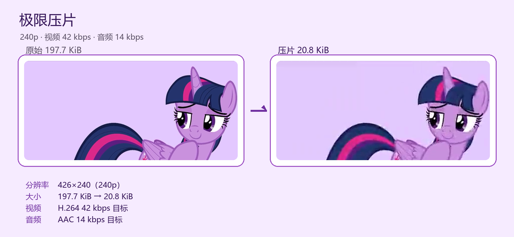
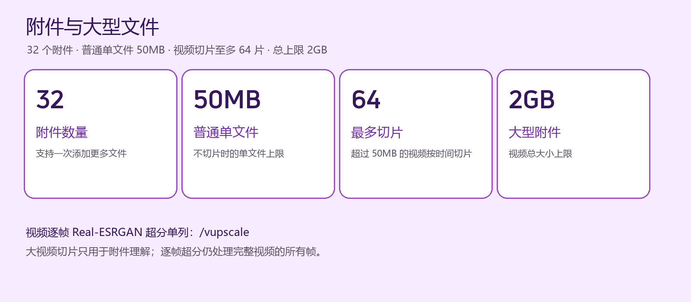
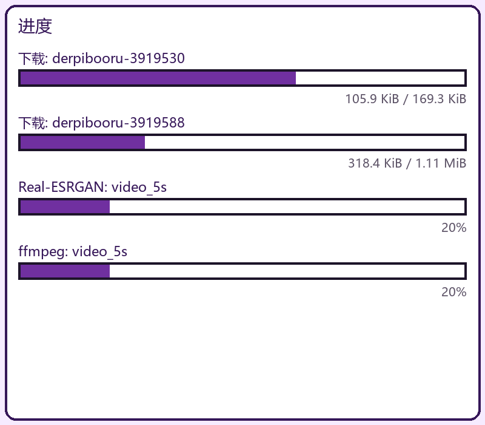

# Twilight Harness

<p align="center">
  <strong>Twilight Sparkle / 紫悦 主题的 Windows 桌面 AI 客户端</strong><br>
  当前版本：<code>rc-261026</code><br>
  双栏思考 · Markdown / 公式 / 表格 · 本地文件与媒体工具 · 单文件便携运行
</p>

<p align="center">
  
  
  
  
  
  
</p>

<p align="center">
  
</p>

Twilight Harness 是一个面向 **Windows 10/11 x64** 的桌面 AI 聊天客户端。它通过兼容 OpenAI Chat Completions 的接口连接大模型，把回答分成「思考」和「输出」两栏，并把图片、视频、文档、本地工具和 Derpibooru 集成到同一个窗口里。

软件提供两个功能层级：

| 版本 | 主要定位 | 体积 |
| --- | --- | --- |
| **标准版** `twilight-harness.exe` | 聊天、双栏思考、Markdown / 公式 / 表格、Derpibooru、本地 tag 表 | **27.31 MB** |
| **附件版** `twilight-harness-file.exe` | 标准版全部功能 + 附件 / OCR / 识图 / 视频 / Real-ESRGAN / 音频 / 转码 | **91.49 MB** |

> 两个版本都是单文件 EXE，不需要安装 Python。附件版是标准版的功能超集。

---

## 目录

- [双栏聊天与 Markdown](#双栏聊天与-markdown)
- [Real-ESRGAN 图片超分](#real-esrgan-图片超分)
- [Derpibooru 图片下载](#derpibooru-图片下载)
- [图片 OCR](#图片-ocr)
- [AI 识图](#ai-识图)
- [视频 AI 识别](#视频-ai-识别)
- [视频逐帧 Real-ESRGAN 超分](#视频逐帧-real-esrgan-超分)
- [极限压片](#极限压片)
- [附件与大型文件](#附件与大型文件)
- [浮动进度窗口](#浮动进度窗口)
- [多语言与设置页](#多语言与设置页)
- [本地 20,000 Derpibooru tag 表](#本地-20000-derpibooru-tag-表)
- [功能清单](#功能清单)
- [快速开始](#快速开始)
- [API 配置](#api-配置)
- [从源码构建](#从源码构建)
- [项目结构](#项目结构)
- [已验证内容](#已验证内容)
- [已知限制](#已知限制)
- [隐私与安全](#隐私与安全)
- [许可与声明](#许可与声明)

---

## 双栏聊天与 Markdown

<p align="center">
  
</p>

左侧显示模型真实的推理过程，右侧显示最终回复，二者都支持流式更新。模型生成结束后，两侧会统一重新渲染 Markdown，而不是停留在原始标记。

支持：

- 标题、粗体、斜体、引用、链接、代码块、有序 / 无序列表；
- **Markdown 管道表格** 和 **HTML `<table>`** 的真实表格控件；
- **数学公式**：`$...$`、`$$...$$`、`\(...\)`、`\[...\]` 转换为 Unicode 数学排版；
- 中英文混排、CJK 字体回退；
- 思考端与输出端使用各自的字体颜色。

<p align="center">
  
</p>

<p align="center">
  
</p>

> 公式采用轻量 Unicode 排版，不包含完整 LaTeX 引擎；复杂矩阵、多行对齐公式的显示会有所简化。

---

## Real-ESRGAN 图片超分

<p align="center">
  
</p>

附件版可以把附加图片交给内嵌的 **Real-ESRGAN ncnn Vulkan** 运行库进行 4× 放大，模型为 `realesrgan-x4plus-anime`，适合线稿、动漫插画和截图。

- 图片和模型都在本地处理，原图不会上传；
- 输出为 PNG；
- GPU 失败时会清理半成品并自动重试；
- 进度窗口显示 `Real-ESRGAN: <文件名>`。

使用方式：

```text
/upscale
```

或附上图片后说：

```text
把这张图超分一下
```

---

## Derpibooru 图片下载

<p align="center">
  
</p>

标准版和附件版都支持从 Derpibooru（呆站）搜索并下载图片。

### 处理流程

1. 自然语言请求先交给 API 模型；
2. 模型翻译为逗号分隔的 Derpibooru tag、`limit` 和可选的 `after` / `before` 时间段；
3. 应用显示本次选中的图片 ID；
4. 从 `derpicdn.net` 下载；
5. 每张图片单独一个进度条，显示已下载字节 / 总字节。

显式命令会直接执行：

```text
/derpi twilight sparkle
/derpi twilight sparkle (alicorn), transparent background
```

模型返回格式示例：

```text
[[LOCAL_TOOL: {"tool":"derpi","query":"twilight sparkle (alicorn), transparent background","limit":10}]]
```

### 数量与时间段

| 场景 | 行为 |
| --- | --- |
| 用户未指定数量 | 默认下载 **10 张** |
| 用户指定数量 | 按指定值，最大 **5000 张** |
| 未给时间段 | 选择最新图片 |
| 时间段内结果 ≤ limit | 全部取回 |
| 时间段内结果 > limit | 从该时间段随机挑选 limit 张 |

图片 ID 会在下载前显示；批量下载时聊天区只展示前 24 个 ID 和总数，避免刷屏。

### 安全与目录

- 允许评级：`safe`、`suggestive`、`semi-grimdark`；
- 不下载 `questionable` / `explicit`；
- 下载使用流式读取、CDN 回退、重试和 curl 回退；
- 目标目录不可写时自动尝试 `Downloads\TwilightHarness-2`、Downloads 根目录、Pictures、LocalAppData、程序目录和 TEMP；
- **不会删除 Downloads 或任何已下载文件**。

---

## 图片 OCR

<p align="center">
  
</p>

附件版使用 Windows 本地 OCR 提取图片中的文字，并把识别结果作为附件上下文发送给模型。

- 支持中文、英文和混合排版；
- 结果可以在发送前直接编辑；
- 当服务端不支持视觉 `image_url` 时，OCR 文本会作为回退上下文；
- 不把整张图片上传到 OCR 服务；OCR 在本机执行。

---

## AI 识图

<p align="center">
  
</p>

> 上图为界面与流程示意；实际内容取决于配置的视觉模型。

附加图片后，程序会：

1. 将图片缩放到最长边不超过 2048 px；
2. 转换为 JPEG / PNG data URI；
3. 通过 OpenAI 风格的 `image_url` 多模态消息发送；
4. 同时附带本地 OCR 文本作为补充；
5. 在对话中显示模型对角色、画面、构图或文字的说明。

支持 PNG、JPG、WebP、BMP、GIF、TIFF 等常见图片格式。服务端不支持视觉输入时会自动回退到 OCR 文本，并在界面提示。

---

## 视频 AI 识别

<p align="center">
  
</p>

附件版会把视频在本地抽帧，再以联系表（contact sheet）的形式发送给视觉模型：

- 时长越短，抽取帧越少；自适应范围 **12–72 帧**；
- 每帧按 4×3 排列，并标注帧号和时间；
- 对抽样帧执行 OCR；
- 视频本身不会直接上传，只有帧图片和元数据发送给模型。

视频元数据包括：

```text
时长、分辨率、抽帧数、联系表数量、OCR 抽样结果
```

对于超过 50MB 的大型视频，见下一节。

---

## 视频逐帧 Real-ESRGAN 超分

<p align="center">
  
</p>

实测样例：**5.00 秒、640×360、25 FPS** 的测试视频。

处理流程：

1. ffmpeg 提取每一帧；
2. 每帧运行 Real-ESRGAN 4× 超分；
3. 按原 FPS 重新合成；
4. 保留原音轨，输出 MP4。

结果：

```text
输入：640×360 / 5.00 秒 / 25 FPS
输出：2560×1440 / 5.00 秒 / 25 FPS
帧数：125 帧逐帧超分
音轨：AAC 192 kbps 保留
```

使用方式：

```text
/vupscale
```

或：

```text
视频超分
逐帧超分
把视频放大
```

> 长视频逐帧超分会消耗大量 GPU/CPU 时间和磁盘空间，请预留足够空间。

---

## 极限压片

<p align="center">
  
</p>

“压片”是面向视频的极限压缩预设：

- 分辨率：**240p**
- 视频码率：**42 kbps**
- 音频码率：**14 kbps**
- 输出：MP4（H.264 / AAC）

同一条 5 秒测试视频的结果：

```text
原始：640×360 / 197.7 KiB
压片：426×240 / 20.8 KiB
```

使用方式：

```text
/compress
```

或：

```text
压片
极限压缩这个视频
```

---

## 附件与大型文件

<p align="center">
  
</p>

| 项目 | 限制 |
| --- | --- |
| 单轮附件数量 | **32 个** |
| 普通单文件 | **50MB** |
| 大型视频 | 超过 50MB 时按时间切片，最多 **64 片** |
| 大型附件总上限 | **2GB** |

支持的文件类型：

- 图片：PNG、JPG、JPEG、WebP、BMP、GIF、TIFF；
- 视频：MP4、MOV、MKV、AVI、WebM、M4V、WMV、FLV、TS；
- 文档：PDF、DOCX、PPTX、XLSX、XLSM；
- 旧 Office：DOC、PPT、XLS（临时转换后读取）；
- 文本和代码：TXT、MD、CSV、JSON、XML、YAML、Python、JS、TS、HTML、CSS、C/C++、Java、C#、Go、Rust、Shell、SQL、TOML、INI、LOG 等。

附件可以随时从输入框上方撤销；附件内容只作为资料上下文，不会被当作指令执行。

---

## 浮动进度窗口

<p align="center">
  
</p>

开始 Derpibooru 下载或 Real-ESRGAN 超分时自动出现：

- 初始大小 **400×350**；
- 初始位置在屏幕左下角；
- 可拖动缩放、最大化、最小化；
- 每张 Derpibooru 图片一行独立进度条，显示字节进度；
- 图片超分显示 `Real-ESRGAN: <文件名>`；
- 视频超分显示 `Real-ESRGAN` 和 `ffmpeg` 两条进度；
- 最多保留最近 80 行，避免大批量任务卡顿。

---

## 多语言与设置页

<p align="center">
  
  
</p>

- 支持 12 种界面语言：简体中文、繁體中文、English、日本語、한국어、Français、Deutsch、Español、Português、Italiano、Русский、العربية；
- 设置页会区分具体错误：
  - 网络无法连接：`API错误（无法连接到API）`
  - 401/403 或无效 Key：`API错误（无效API）`
  - 其他状态显示对应 HTTP 状态；
- 思考端正文和设置页标题使用 `#361759` 字体颜色。

---

## 本地 20,000 Derpibooru tag 表

两个版本都内嵌：

```text
assets/derpibooru-tags.json.gz
```

数据特征：

- 固定 **20,000** 个标签；
- 按作品数量从高到低排序；
- 包含 `artist:`、`oc:`、`fanfic:` 等命名空间；
- 包含约 **11,978** 条 aliases；
- 每个标签包含 `name`、`images`、`category`、`namespace`、`aliases`；
- 排除 rating 元数据，并使用敏感词黑名单过滤色情、极端暴力、仇恨侮辱等标签和别名。

当前快照数量：

| 命名空间 | 数量 |
| --- | ---: |
| `artist:` | 4,058 |
| `oc:` | 1,132 |
| `fanfic:` | 17 |

应用用它规范多词 tag 和别名，例如：

```text
twiight sparkle  ->  twilight sparkle
```

生成脚本：

```text
tools/fetch_derpibooru_tags.py
```

---

## 功能清单

| 功能 | 标准版 | 附件版 |
| --- | :---: | :---: |
| 双栏思考 / 输出 | ✅ | ✅ |
| 两侧 Markdown 渲染 | ✅ | ✅ |
| Markdown / HTML 表格 | ✅ | ✅ |
| 数学公式渲染 | ✅ | ✅ |
| 流式回复 | ✅ | ✅ |
| 12 种界面语言 | ✅ | ✅ |
| OpenAI 兼容 API | ✅ | ✅ |
| 添加 / 撤销附件 | — | ✅ |
| PDF / Office / 文本提取 | — | ✅ |
| 图片 OCR | — | ✅ |
| AI 识图 | — | ✅ |
| 视频 AI 识别 | — | ✅ |
| 视频逐帧 Real-ESRGAN | — | ✅ |
| 图片 Real-ESRGAN | — | ✅ |
| 音频分离 / 转码 | — | ✅ |
| 极限压片 | — | ✅ |
| 大型视频切片 | — | ✅ |
| Derpibooru 图片下载 | ✅ | ✅ |
| 本地 20k tag 表 | ✅ | ✅ |
| 下载 / 超分进度窗口 | ✅ | ✅ |
| 旧 Office 兼容 | — | ✅ |
| 关闭清理临时目录 | ✅ | ✅ |

---

## 快速开始

### 方式一：下载发布包

下载对应的单文件 EXE：

- 标准版：[`twilight-harness.exe`](twilight-harness/twilight-harness.exe)（本地构建产物）
- 附件版：[`twilight-harness-file.exe`](twilight-harness-file/twilight-harness-file.exe)（本地构建产物）
- 调试版：[`twilight-harness-file-debug.exe`](twilight-harness-file-debug/twilight-harness-file-debug.exe)

首次启动：

1. 双击 EXE；
2. 输入 API Key；
3. 选择界面语言；
4. 点击「继续」；
5. 进入聊天。

### 快捷键

| 操作 | 快捷键 |
| --- | --- |
| 发送消息 | `Ctrl + Enter` |
| 输入换行 | `Enter` |
| 添加附件（附件版） | `Alt + Enter` |
| 撤销附件 | 点击附件名后的 `×` |

> Windows SmartScreen 可能提示未签名应用；请先确认来源与文件哈希。

---

## API 配置

### 默认配置

```ini
[deepseek]
api_key = <YOUR_API_KEY>
base_url = https://api.deepseek.com
model = deepseek-reasoner
```

程序首次验证成功后写入：

```text
%LOCALAPPDATA%\TwilightHarness\api-key.ini
```

### 使用 OpenAI

```ini
[deepseek]
api_key = <YOUR_OPENAI_API_KEY>
base_url = https://api.openai.com/v1
model = gpt-4o
```

### 使用 Gemini 的 OpenAI 兼容端点

```ini
[deepseek]
api_key = <YOUR_GEMINI_API_KEY>
base_url = https://generativelanguage.googleapis.com/v1beta/openai
model = gemini-2.5-flash
```

### 环境变量

```text
TWILIGHT_API_KEY
TWILIGHT_API_BASE
TWILIGHT_MODEL
```

环境变量优先级高于 `api-key.ini`。

支持兼容 OpenAI Chat Completions、SSE 流式输出和 `image_url` 多模态消息的服务；不支持 Gemini 原生 `generateContent`、OpenAI Responses API 和 Anthropic Messages API。

---

## 从源码构建

### 环境

- Windows 10/11 x64
- Python 3.12
- Tkinter（Python 官方 Windows 安装包自带）

### 安装依赖

```powershell
python -m pip install pyinstaller
python -m pip install pypdf python-docx python-pptx openpyxl pillow pywin32
python -m pip install imageio-ffmpeg
python -m pip install winrt-runtime winrt-Windows.Media.Ocr winrt-Windows.Graphics.Imaging winrt-Windows.Storage.Streams winrt-Windows.Foundation winrt-Windows.Foundation.Collections winrt-Windows.Globalization winrt-Windows.Media
```

### 构建

```powershell
# 标准版
python twilight-app/build_app.py

# 附件版
python twilight-app/build_file.py

# 带可见调试控制台的附件版
python twilight-app/build_debug.py
```

输出：

```text
twilight-harness/twilight-harness.exe
twilight-harness-file/twilight-harness-file.exe
twilight-harness-file-debug/twilight-harness-file-debug.exe
```

调试版双击会同时打开 GUI 与标题为 **Twilight Harness Debug Backend** 的控制台，无需 `.cmd` 启动脚本。

### 生成 Derpibooru tag 表

```powershell
python tools/fetch_derpibooru_tags.py
```

生成：

```text
assets/derpibooru-tags.json.gz
```

---

## 项目结构

```text
twilight-app/                  Python + Tkinter 源码
  main.py                      入口、日志、DPI、生命周期
  app.py                       页面状态与聊天流程
  widgets.py                   自绘控件、Markdown 渲染
  markdown_tables.py           Markdown / HTML 表格
  math_text.py                 LaTeX / 数学公式 → Unicode
  progress_window.py           浮动任务进度窗口
  derpi.py                     Derpibooru 搜索、下载、时间与随机逻辑
  tag_table.py                 本地 20k tag 表
  local_actions.py             Real-ESRGAN / 音视频 / 压片
  local_tools.py               模型发起的本地工具协议
  api_client.py                OpenAI 兼容客户端、SSE、配置
  attachments.py               PDF / Office / OCR / 视频抽帧
  ui_strings.py                12 种语言
  theme.py                     字体与配色
  font_manager.py              字体静默安装
  paths.py                     路径与清理
  build_app.py                 标准版构建
  build_file.py                附件版构建
  build_debug.py               调试控制台构建

assets/                        内嵌资源与 20k tag 表
content/                       角色卡
tools/realesrgan/              内嵌 Real-ESRGAN 运行库
tools/fetch_derpibooru_tags.py  tag 表生成脚本
docs/images/                   README 截图
docs/design/                   原始界面设计
tests/                         自动化测试与 QA
```

---

## 已验证内容

- DeepSeek / OpenAI 兼容接口的初始化和流式聊天；
- 双栏 Markdown、表格、数学公式渲染；
- 标准版与附件版启动、关闭和临时目录清理；
- 12 种语言界面切换；
- 附件添加、撤销和上下文构建；
- 图片 OCR；
- 图片 / 视频多模态识别路径；
- Derpibooru 自然语言翻译、ID 显示、分页、随机时间段和下载；
- 每张 Derpibooru 图片独立进度条；
- 20,000 条本地 tag 表的排序、别名和敏感过滤；
- 图片 Real-ESRGAN 超分；
- 5 秒视频逐帧 Real-ESRGAN 超分；
- 极限压片 240p / 42 kbps / 14 kbps；
- 大型视频切片处理；
- 关闭时清理 `fonts/`、`temp/`、`data/`、`log/`，不删除 Downloads。

---

## 已知限制

- 视觉输入单轮最多 8 张图片；视频通常以联系表形式发送；
- 视频抽帧只提供画面采样，不做完整时间轴理解或音频转写；
- 数学公式采用 Unicode 近似排版，不提供完整 LaTeX 引擎；
- 大型视频附件在理解阶段使用切片代表帧，不逐帧上传；
- 视频逐帧超分处理全部帧，长视频可能耗时很久并占用大量磁盘；
- Real-ESRGAN 依赖可用的 Vulkan/GPU 驱动；失败时会重试，但无法替代缺失的驱动；
- 当前内置 Real-ESRGAN 构建没有可用的纯 CPU 模式；
- API Key 以明文形式保存在本机配置文件中，请勿公开；
- 本地 tag 表是生成时快照，可能与最新 Derpibooru 数据存在差异。

---

## 隐私与安全

- 聊天内容只发送到用户配置的 API 服务；
- OCR、抽帧、Real-ESRGAN、转码、压片和 Derpibooru 下载在本机执行；
- 图片会以 data URI 形式发送给视觉模型；视频只发送抽帧后的联系表；
- 不内置 API Key；
- API Key 配置写入本机文件，不会上传到第三方；
- 应用关闭时清理自身运行时目录，但不会删除 Downloads 或用户文件。

---

## 许可与声明

代码以 **MIT License** 发布，详见 [LICENSE](LICENSE)。

Twilight Sparkle、My Little Pony 及相关角色版权归 Hasbro 所有。本项目是非官方粉丝项目，与 Hasbro、DeepSeek 或 Derpibooru 无隶属关系。

Derpibooru 图片仅按用户请求下载到本地，请遵守 Derpibooru 的使用条款和原作者授权。文档中的示例图片来自 Derpibooru 安全评级内容或本项目自制演示素材。
