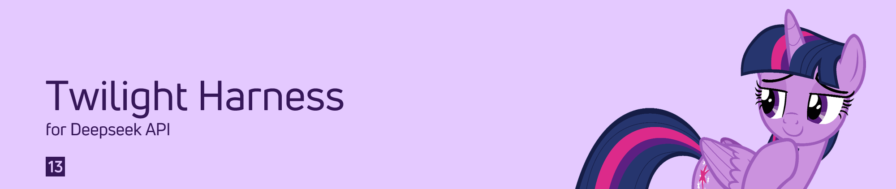
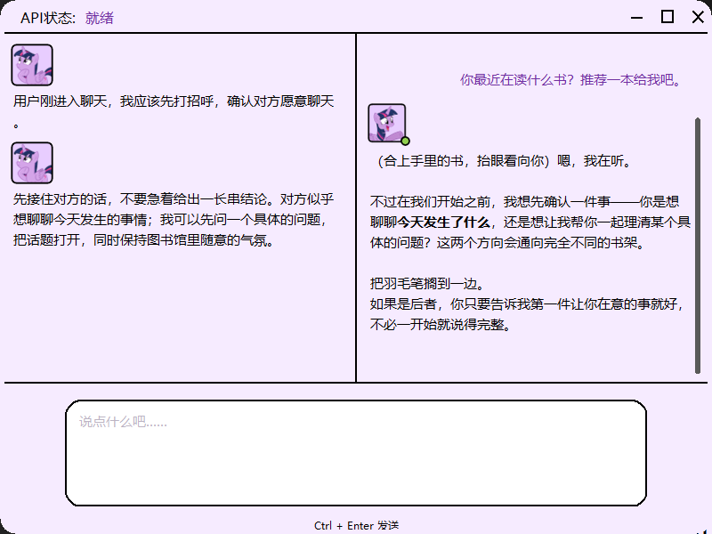
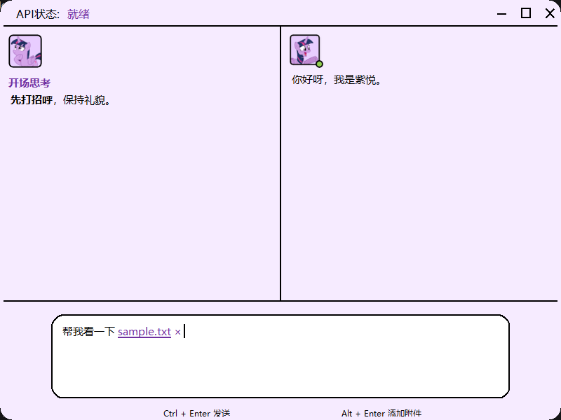
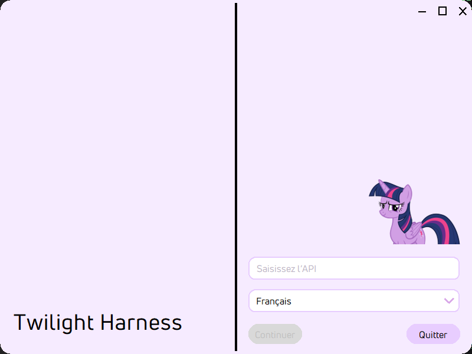
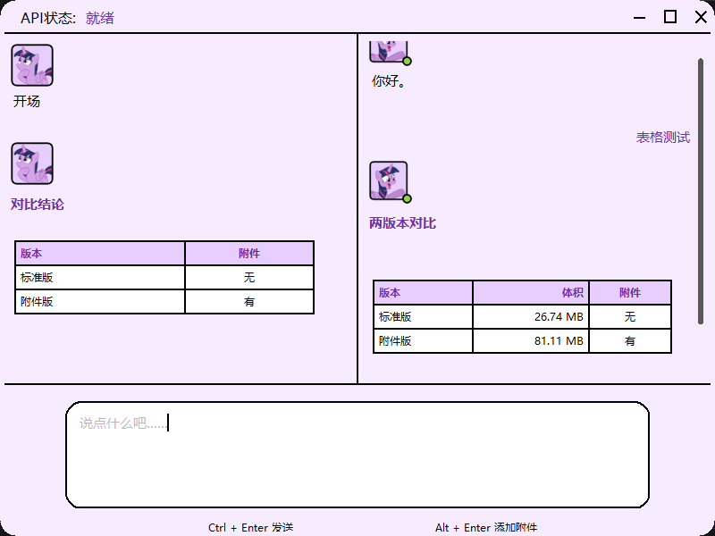

# Twilight Harness · 紫悦

<p align="center">
  <strong>一个以 Twilight Sparkle / 紫悦 为主题的 Windows 桌面 AI 聊天客户端</strong><br>
  双栏思考 · Markdown 输出 · 多语言界面 · 单文件便携运行
</p>

<p align="center">
  
  
  
  
  
</p>

<p align="center">
  
</p>

Twilight Harness 是一个 **Windows 10/11 x64** 桌面应用。它通过兼容 OpenAI Chat Completions 的接口连接大模型，把回复分成「思考」与「输出」两栏，并支持流式显示、Markdown 渲染和 12 种界面语言。

项目目前提供两个相互独立的单文件 EXE：

| 版本 | 主要定位 | 体积 |
| --- | --- | --- |
| **标准版** `twilight-harness.exe` | 纯聊天 + 双栏思考 + Markdown / 表格 | **27.28 MB** |
| **附件版** `twilight-harness-file.exe` | 标准版全部功能 + 附件 / OCR / 识图 / 视频 / 本地工具 / 旧 Office 兼容 | **91.45 MB** |

> 标准版不显示附件入口；附件版是功能超集，两者共享同一套 UI、API 配置和运行时清理机制。

---

## 预览

| 设置界面 | 标准版聊天 |
| --- | --- |
|  |  |

| 附件版：可撤销的附件引用 | 多语言界面（Français） |
| --- | --- |
|  |  |

---

## 两个版本

| 能力 | 标准版 | 附件版 |
| --- | :---: | :---: |
| 双栏思考 / 输出 | ✅ | ✅ |
| 两侧 Markdown 渲染 | ✅ | ✅ |
| Markdown / HTML 表格渲染 | ✅ | ✅ |
| 数学函数 / 公式渲染 | ✅ | ✅ |
| 流式回复 | ✅ | ✅ |
| 12 种界面语言 | ✅ | ✅ |
| OpenAI 兼容 API | ✅ | ✅ |
| 添加附件 | — | ✅ |
| 可撤销附件引用 | — | ✅ |
| PDF / Word / PowerPoint / Excel / 文本提取 | — | ✅ |
| 图片 OCR | — | ✅ |
| AI 识图（图片 / 视频抽帧） | — | ✅ |
| 视频附件 | — | ✅ |
| ffmpeg 音频分离 / 转码 | — | ✅ |
| “压片”极限压缩（240p / 42kbps / 14kbps） | — | ✅ |
| Real-ESRGAN 超分辨率 | — | ✅ |
| Derpibooru 图片下载 | ✅ | ✅ |
| 本地 20,000 Derpibooru tag 表 | ✅ | ✅ |
| `.doc/.ppt/.xls` 临时转换 | — | ✅ |
| 关闭清理 `fonts/`、`temp/`、`data/`、`log/` | ✅ | ✅ |

---

## 核心特性

### 桌面体验

- **800 × 600、无边框、可缩放**的薰衣草色界面；
- 自绘标题栏、窗口控制按钮、拖拽缩放；
- 左侧思考、右侧输出，分别显示紫悦的推理与对话；
- 紫悦头像会根据在线、思考、离线状态切换；
- 字体、图标、开场图、角色卡全部内嵌在 EXE 中。

### 双栏 Markdown

思考端和输出端都会在生成完成后重新渲染 Markdown，支持：

- 标题 `#`
- 粗体、斜体
- 行内代码和代码块
- 有序 / 无序列表
- 引用块
- 链接显示文本
- **Markdown 管道表格**
- **HTML `<table>` 表格**
- **数学函数与公式**：`$...$`、`$$...$$`、`\(...\)`、`\[...\]` 会转换为 Unicode 数学记号

表格会渲染成带边框、表头和列对齐的真实控件；中文、英文混排也会按列显示，而不是输出原始 `|` 文本。

<p align="center">
  
</p>

流式生成期间可能短暂显示原始标记，生成完成后统一变为格式化文本。

### 设置页错误提示

设置页会区分具体失败场景：

- 网络无法连接：`API错误（无法连接到API）`
- 401/403 或无效 Key：`API错误（无效API）`
- 其他 HTTP 状态：显示对应 HTTP 状态

思考端正文和设置页 “Twilight Harness” 标题使用 `#361759` 字体颜色。

### 12 种语言

简体中文、繁體中文、English、日本語、한국어、Français、Deutsch、Español、Português、Italiano、Русский、العربية。

设置页和聊天界面会随语言切换字体与排版；模型回复也会使用设置页选择的语言。

### 单文件便携运行

- PyInstaller **one-file** 打包；
- 首次启动在 EXE 同级释放 `fonts/`、`temp/`；
- 关闭时删除 `fonts/`、`temp/`，标准版和附件版都会清理；
- 附件版还会清理 WPS 产生的 `data/`、`log/` 残留；
- API Key 配置单独保存在 `%LOCALAPPDATA%\TwilightHarness\api-key.ini`，不会随临时目录删除。

---

## 附件版增强

### 添加与撤销附件

附件版输入框下方增加：

```text
Ctrl + Enter 发送        Alt + Enter 添加附件
```

添加附件后，输入框中会显示：

```text
文件名 ×
```

- 点击 `×`：立即撤销该附件引用，并从待发送列表移除；
- 直接删除输入框中的附件引用文字：发送时会过滤掉已删除的附件；
- 发送后的用户消息只显示带下划线的文件名，不显示 `×`。

### 支持识别的文件

| 类型 | 能力 |
| --- | --- |
| `.pdf` | 提取文本（扫描版 PDF 不做 OCR） |
| `.docx` | 段落、表格 |
| `.pptx` | 幻灯片文本、备注 |
| `.xlsx/.xlsm` | 工作表单元格 |
| `.txt/.md/.csv/.json/.yaml/.xml/.log` 等 | 纯文本 |
| Python / JS / HTML / C/C++ 等源码 | 纯文本 |
| `.doc/.ppt/.xls` | 通过 Office/WPS COM 临时转成 OOXML 后读取 |
| `.png/.jpg/.jpeg/.bmp/.webp/.gif/.tiff` | Windows OCR + 视觉模型识图 |
| `.mp4/.mov/.mkv/.avi/.webm/.m4v/.wmv/.flv/.ts` | 自适应抽取 12–72 帧 + 联系表 + 视频帧 OCR + 视觉模型识图 |

### 图片 OCR

- 使用 Windows 自带 OCR 引擎（Windows.Media.Ocr）；
- 需要系统安装对应 OCR 语言包；
- OCR 提取到的文字会作为附件上下文发送给模型；
- 图片同时可以被支持视觉的模型直接查看。

### AI 识图 / 视频理解

附件版会把图片压缩为最长边 2048 px 的 JPEG，并通过 OpenAI Chat Completions 兼容的 `image_url` 多模态格式发送给模型。

视频会使用内置 ffmpeg 根据时长自适应抽取 **12–72 帧**，按 4×3 排列成联系表（contact sheet），并抽 12 帧做本地 OCR。模型看到的是联系表和 OCR 文本，而不是原始视频；视频本身不会上传。

- 支持视觉的模型可直接描述、识别、分析图片；
- 默认单轮最多发送 8 张视觉图片；视频以联系表形式发送。
- 如果模型不支持图片输入（例如文本模型返回 400/415/422），程序会自动移除图片，改用本地 OCR 文本重试，并在思考栏提示：

  > 当前模型不支持图片输入，已自动改用图片文字识别。

因此，即使使用纯文本模型，图片附件也不会直接导致对话失败。

### 旧版 Office 兼容层

对于 `.doc`、`.ppt`、`.xls`：

1. 通过本机 Microsoft Office 或 WPS 的 COM 接口打开文件；
2. 临时转换为 `.docx`、`.pptx`、`.xlsx`；
3. 使用本地解析库读取内容；
4. 读取完成后删除临时转换文件。

转换需要本机安装 Microsoft Office 或 WPS；未安装时会显示对应错误提示，不会上传原始文件到其他服务。

### 本地工具

显式 `/derpi`/`/upscale`/`/audio`/`/transcode` 命令会由本地执行；自然语言请求则先由配置的 API 模型翻译成标签、工具命令和时间参数，再自动触发本地工具。

所有本地工具都不会删除用户的 Downloads 文件夹。

- **标准版**：支持 Derpibooru 图片搜索下载；
- **附件版**：额外支持 Real-ESRGAN 超分、视频音频分离、视频转码。

Derpibooru 搜索允许 **safe / suggestive / semi-grimdark** 三个评级，对应标准 default filter，不使用 safe-only 过滤。

查询遵循 Derpibooru 的 tag 规则：

- 多个 tag 使用英文逗号连接，表示 AND 叠加；
- tag 内部的英文括号、英文句点、感叹号、问号原样保留；
- 示例：`twilight sparkle (alicorn), alicorn`、`ms. peachbottom, what?`；
- 评级词由程序统一处理，无需写入 query。

| 命令 | 需要附件 | 输出 |
| --- | --- | --- |
| `/derpi <tags>` | 无 | 从 Derpibooru 搜索 safe / suggestive / semi-grimdark 图片，经 `derpicdn.net` 下载到 Downloads |
| `/upscale` | 图片 | Real-ESRGAN x4 动漫模型超分，保存 PNG |
| `/audio` | 视频 | 分离音轨，保存 M4A |
| `/transcode webm` | 视频 | 转码为 mp4 / webm / mkv / mov / gif，可设码率/分辨率/音频码率 |
| `/compress` 或“压片” | 视频 | 极限压缩：240p、42 kbps 视频、14 kbps 音频 |

自然语言也会触发对应工具，例如：

- “帮我找几张紫悦的呆站图片”
- 附加图片后说“把这张图超分一下”
- 附加视频后说“提取音频”或“转码成 webm，分辨率 720p，视频码率 2M”

对于 Derpibooru，自然语言不会直接请求 API，而是先让模型翻译为例如：

```text
[[LOCAL_TOOL: {"tool":"derpi","query":"twilight sparkle (alicorn), transparent background","limit":10,"after":"2024-01-01","before":"2025-01-01"}]]
```

然后本地工具再访问 Derpibooru；用户未指定数量时默认抓取 **10 张**；`limit` 最大为 **5000**。没有时间段时选择最新图片；时间段内结果多于 `limit` 时随机挑选 `limit` 张；结果不足时取全部。大量图片会分页搜索并并发下载，可能需要较长时间。

搜索完成后会先在聊天区显示本次选中的 Derpibooru 图片编号（数量很大时只显示前 24 个和总数），再开始从 `derpicdn.net` 下载。下载会优先使用完整图片，失败时回退到 CDN 的 large/medium/small 表示，并使用 curl 作为 TLS/反爬回退；如果全部失败，编号仍会保留，错误信息会附带图片 ID 与具体原因。结果很多时聊天区只展示前 40 个文件路径和所在目录。

如果 Downloads 目录本身不可写（例如被 Windows 受控文件夹访问拦截），会明确提示目录不可写，而不是笼统地报“没有可下载图片”。

“压片”预置参数：

```text
/compress
```

或直接说“压片”“极限压缩这个视频”。输出为 MP4，240p，视频 42 kbps，音频 14 kbps。

转码参数示例：

```text
/transcode mp4 video_bitrate=2M resolution=720p audio_bitrate=128k fps=30
```

模型也可以通过 API 返回本地工具命令，自动触发同一套功能：

```text
[[LOCAL_TOOL: {"tool":"derpi","query":"sunny starscout"}]]
[[LOCAL_TOOL: {"tool":"transcode","format":"webm","video_bitrate":"2M","resolution":"720p","audio_bitrate":"128k"}]]
```

应用会隐藏这些命令，在回复结束后执行本地工具并显示文件路径。标准版只执行 Derpibooru 工具；附件版执行全部工具。

输出目录：

```text
%USERPROFILE%\Downloads\TwilightHarness\
```

该目录只在下载时写入，应用关闭清理不会触碰 Downloads。

如果 `Downloads\TwilightHarness` 因 ACL、杀毒软件或 Windows 受控文件夹访问而不可写，程序会依次尝试 `Downloads\TwilightHarness-2`、Downloads 根目录、`Pictures\TwilightHarness`、`%LOCALAPPDATA%\TwilightHarness\downloads`、EXE 目录下的 `downloads` 和系统 TEMP，并在结果中显示实际路径，不会删除任何目录。

### 本地 Derpibooru tag 表

两个版本都内嵌一份本地 tag 表：

```text
assets/derpibooru-tags.json.gz
```

数据特征：

- 按 Derpibooru 作品数量（`images`）从高到低排列；
- 固定收录 **20,000** 个标签；
- 包含 `artist:`、`oc:`、`fanfic:` 等命名空间标签；
- 每个标签包含 `name`、`images`、`category`、`namespace` 与 `aliases`；
- 排除 rating 元数据标签，并用敏感词黑名单过滤色情、极端暴力、仇恨侮辱等标签及别名；
- 压缩 JSON，便于随 EXE 内嵌和本地快速加载。

应用会用它解析多词 tag 和别名，例如把用户写法规范到实际 tag 名称，减少无效搜索。生成脚本：

```text
tools/fetch_derpibooru_tags.py
```

当前快照包含：`artist:` 标签 4,058 个、`oc:` 标签 1,132 个、`fanfic:` 标签 17 个，共收录约 11,978 条 aliases。

数据是生成时的快照，不会自动联网更新；需要更新时重新运行脚本并重建 EXE。

### 附件限制

- 文档/图片单文件最大 **25 MB**
- 视频单文件最大 **250 MB**
- 最多 **5 个附件**
- 文档单文件最多 **60,000 字符**
- 总附件上下文最多 **90,000 字符**
- 单轮最多 **8 张视觉图片**（长视频通常为 6 张联系表）
- 视频帧数按时长在 **12–72** 之间自适应
- 超出限制会截断或提示

---

## 快速开始

### 方式一：下载发布包

从仓库的 **Releases** 页面下载对应版本的 EXE：

- 标准版：`twilight-harness.exe`
- 附件版：`twilight-harness-file.exe`

两个版本都是单文件，不需要安装 Python。

### 方式二：本地构建

详见下方「从源码构建」。

### 首次启动

1. 双击 EXE；
2. 等待字体释放和静默注册；
3. 输入 API Key；
4. 选择界面语言；
5. 点击「继续」；
6. 进入聊天后：
   - `Enter`：换行
   - `Ctrl + Enter`：发送
   - 附件版 `Alt + Enter`：添加附件
   - 附件名后的 `×`：撤销附件引用

> Windows SmartScreen 可能提示未签名应用，这是正常现象；可先检查文件哈希和来源。

---

## API 配置

### 默认配置

程序默认使用 DeepSeek 兼容接口，API Key 通过设置页输入。

首次成功验证后，配置会写入：

```text
%LOCALAPPDATA%\TwilightHarness\api-key.ini
```

格式如下：

```ini
[deepseek]
api_key = <YOUR_API_KEY>
base_url = https://api.deepseek.com
model = deepseek-flash
```

> 节名 `[deepseek]` 是历史兼容名称；即使使用其他兼容服务，也可以保留。

如果首次启动就想直接使用非 DeepSeek 服务，请先手动创建上述 `api-key.ini`，再启动程序；设置页会读取其中的 `base_url` 和 `model`。设置页本身只负责输入 API Key 和选择语言。

### 使用 OpenAI GPT

```ini
[deepseek]
api_key = <YOUR_OPENAI_API_KEY>
base_url = https://api.openai.com/v1
model = gpt-4o
```

### 使用 Gemini 的 OpenAI 兼容端点

```ini
[deepseek]
api_key = <YOUR_GEMINI_API_KEY>
base_url = https://generativelanguage.googleapis.com/v1beta/openai
model = gemini-2.5-flash
```

### 环境变量

适合临时测试或自动化启动：

```text
TWILIGHT_API_KEY
TWILIGHT_API_BASE
TWILIGHT_MODEL
```

环境变量优先级高于 `api-key.ini`。

### 兼容范围

支持：

- DeepSeek Chat Completions
- OpenAI Chat Completions
- 其他兼容 OpenAI Chat Completions 协议、支持 SSE 流式输出的服务

不支持：

- Gemini 原生 `generateContent` 接口
- OpenAI Responses API
- Anthropic 原生 Messages API

附件版的 AI 识图依赖提供方支持 OpenAI 风格的 `image_url` 多模态消息；不支持时会自动回退到本地 OCR 文本。

> API Key 以明文形式保存在本机配置文件中，请勿将配置文件或截图中的 Key 公开。

---

## 从源码构建

### 环境

- Windows 10/11 x64
- Python 3.12
- Tkinter（Python 官方 Windows 安装包自带）

### 安装构建依赖

```powershell
python -m pip install pyinstaller
python -m pip install pypdf python-docx python-pptx openpyxl pillow pywin32
python -m pip install imageio-ffmpeg
python -m pip install winrt-runtime winrt-Windows.Media.Ocr winrt-Windows.Graphics.Imaging winrt-Windows.Storage.Streams winrt-Windows.Foundation winrt-Windows.Foundation.Collections winrt-Windows.Globalization winrt-Windows.Media
```

`winrt-*` 和 `pywin32` 主要用于附件版的 OCR 与旧 Office 转换；标准版构建不依赖这些运行时。

### 构建

```powershell
# 标准版
python twilight-app/build_app.py

# 附件版
python twilight-app/build_file.py

# 带可见调试后台控制台的附件版
python twilight-app/build_debug.py
```

构建输出：

```text
twilight-harness/twilight-harness.exe
twilight-harness-file/twilight-harness-file.exe
twilight-harness-file-debug/twilight-harness-file-debug.exe
```

调试构建使用 PyInstaller `--console`，双击 EXE 会同时打开 GUI 与标题为
“Twilight Harness Debug Backend”的调试控制台，不需要额外的 `.cmd`
启动脚本；关闭 GUI 后控制台随之关闭。调试日志同时写入
`temp/twilight-harness.log`。

### 直接运行源码

```powershell
python twilight-app/main.py
```

源码运行用于开发调试：不会收尾删除 EXE 同级的 `fonts/`，也不会执行 `data/`、`log/` 的 WPS 侧写清理；`temp/` 仍会作为日志和运行时目录使用。

---

## 项目结构

```text
twilight-app/              Python + Tkinter 源码
  main.py                  入口、日志、DPI、生命周期
  app.py                   页面状态与聊天流程
  widgets.py               自绘控件、窗口按钮、Markdown 渲染
  markdown_tables.py       Markdown / HTML 表格渲染
  math_text.py             LaTeX/数学公式到 Unicode 的转换
  derpi.py                 Derpibooru 搜索、评级过滤与 derpicdn 下载
  tag_table.py             本地 20k tag 表加载、别名与多词 tag 解析
  local_actions.py         Real-ESRGAN / 音视频本地工具（附件版）
  local_tools.py           模型发起的本地工具调用协议
  api_client.py            OpenAI 兼容客户端、SSE、配置
  attachments.py           PDF/Office/图片 OCR/识图提取
  ui_strings.py            12 种语言文案
  theme.py                 字体与配色
  font_manager.py          字体静默安装
  paths.py                 路径与运行时清理
  build_app.py             标准版构建脚本
  build_file.py            附件版构建脚本
  build_debug.py           带调试控制台的附件版构建脚本

assets/                    字体、头像、开场图、Derpibooru tag 表
content/                   角色卡
tools/realesrgan/          内嵌 Real-ESRGAN 运行库与动漫模型
 tools/fetch_derpibooru_tags.py  tag 表生成脚本
docs/images/               README 截图
docs/design/               原始界面与头像设计参考
build/                     图标、图标生成脚本与版本信息
tests/                     自动化测试、UI 探针与 QA 记录
LICENSE                    MIT License（代码）
twilight-harness/          本地构建的标准版产物
twilight-harness-file/     本地构建的附件版产物
```

---

## 已验证内容

- DeepSeek Chat Completions 初始化、聊天和流式输出；
- OpenAI 兼容端点的本地 mock 测试；
- 附件版 AI 识图请求结构（`image_url` 数据 URI）及流式返回；
- 视觉模型不支持图片时的 OCR 自动回退；
- PDF、DOCX、PPTX、XLSX、纯文本提取；
- `.doc/.ppt/.xls` 经 Office/WPS 转换后读取；
- 图片 OCR（中文/英文测试图）；
- 附件引用 `×` 撤销与发送时过滤；
- 思考端、输出端 Markdown / 表格渲染；
- 视频 12–72 帧抽帧、联系表、帧 OCR 和多模态请求；
- Derpibooru 搜索（safe / suggestive / semi-grimdark）、逗号 tag 叠加与 derpicdn.net 下载；
- 本地 20k tag 表与别名解析（artist: 4,058 / oc: 1,132 / fanfic: 17）；
- 数学公式 Unicode 渲染；
- 视频“压片”极限压缩参数；
- 截图中 `sunny starcout` 类拼写会规范为 `sunny starscout`；
- 模型 API 工具调用本地 Derpibooru / Real-ESRGAN / 音频分离 / 视频转码；
- Real-ESRGAN 超分、ffmpeg 音频分离与转码；
- Real-ESRGAN 图片超分；
- ffmpeg 音频分离和视频转码；
- 12 种语言界面；
- 两个 EXE 的启动、字体释放、关闭清理。

> 测试范围仍有限，未覆盖所有 OpenAI 兼容服务、所有图片类型和所有 Office 版本。

---

## 已知限制

- 仅支持 Windows 10/11 x64；
- 发布 EXE 未做代码签名，首次运行可能触发 SmartScreen；
- 不支持 Gemini 原生 API、OpenAI Responses API、Anthropic Messages API；
- 附件版的 `.doc/.ppt/.xls` 转换依赖本机 Microsoft Office 或 WPS；
- 图片 OCR 依赖 Windows OCR 语言包；
- 扫描版 PDF 不会自动 OCR；
- 视频解码、音频分离和转码使用随附件版打包的 ffmpeg；
- 本地 tag 表是生成时快照，可能与最新 Derpibooru 数据存在差异；
- 数学公式采用 Unicode 近似排版，不提供完整 LaTeX 排版引擎。
- AI 识图/视频理解需要视觉模型；文本模型会回退到 OCR 文本；
- 视频按 12–72 帧生成联系表并识别部分画面文字，不做完整时间轴理解或音频转写；
- 没有自动更新器，也没有内置代理设置。

---

## 隐私与安全

- 程序不连接作者自建服务器，也没有遥测；
- 聊天内容、文本附件、图片会发送到你在配置中指定的 API 服务；
- OCR、PDF/Office 文本提取、旧 Office 转换在本机完成；
- API Key 以明文保存在 `%LOCALAPPDATA%\TwilightHarness\api-key.ini`；
- 关闭程序会删除临时字体、临时数据、日志和 WPS 侧写残留；
- 请不要在公开 Issue、截图或提交中暴露 API Key。

---

## 许可与声明

- 仓库代码采用 [MIT License](LICENSE)，Copyright (c) 2026 Hongfei Wan。
- 本项目是 **非官方粉丝项目**，与 Hasbro、DeepSeek 或任何 API 提供方没有隶属关系。
- 《My Little Pony》及 Twilight Sparkle / 紫悦 相关角色、图像和素材版权归 Hasbro 所有，请勿用于商业用途。
- MIT 许可仅覆盖本项目代码；内嵌字体（Uni Neue、Microsoft YaHei、Source Han Sans JP 等）与角色素材仍受各自许可约束；重新分发构建产物前请确认相应授权。
- 使用本项目调用任何模型服务时，请遵守对应服务商的使用条款。

---

<p align="center">
  <sub>Built with Python, Tkinter and a little bit of magic. ✨</sub>
</p>
